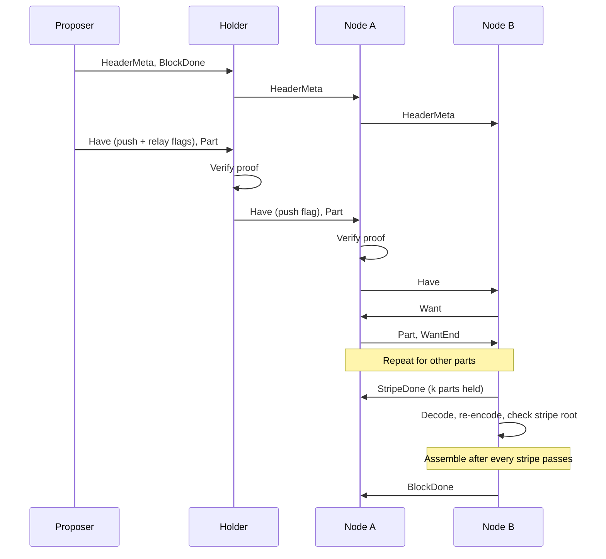

# BPv1: block propagation for Zcash

BPv1 aims to deliver blocks quickly from any proof-of-work proposer across
peers with unequal bandwidth. The proposer splits a block body into
erasure-coded parts and seeds them to its neighbours. Each neighbour pushes its
share one more hop. Every later hop pulls the parts its neighbours announce.
Parity lets a receiver skip slow neighbours once it holds enough parts to
reconstruct the block.

Pull limits redundant traffic. Push saves a request round trip but can overload
the fastest relays. BPv1 therefore pushes only on the first two hops, where a
round trip costs the most, and bounds how many parts each sender may push. The
[protocol specification](../specs/bpv1.md) defines the message rules and
limits. Earlier revisions called this protocol Dogwood.

## Parts and stripes

Each block picks its part size `S` so that the body fits one stripe of 64
source parts, between 4 KiB and 64 KiB. A small block therefore costs about its
own size per node. Each stripe contains `k` source parts, at most 64. The
proposer adds `ceil(k / 3)` parity parts with systematic Reed–Solomon over
GF(2¹⁶), so a stripe has `n = k + ceil(k / 3)` parts. Any `k` distinct
correctly encoded parts reconstruct a stripe.

A 2 MB block has one stripe of 64 source parts of 31,296 bytes and 22 parity
parts. A 128 MiB body has 32 stripes of 64 KiB parts. A body above one stripe
uses 64 KiB parts and more stripes. An empty body has no parts: the header and
coinbase in `HeaderMeta` already make up the whole block.

On the wire a source part ends where the body ends, so the zero padding of the
last stripe never travels.

## Authenticate before forwarding

At template time, the proposer encodes the body and commits the part root in a
zero-value coinbase output, `6a 25 "BPV1" 01 C`. `C` hashes the chain, the
profile, the coding, the part root, and the proposer's node id. The proof of
work covers the header, the header commits the coinbase, and the coinbase
commits `C`. A block therefore has one valid set of metadata, and BPv1 needs no
signature and no conflict rule.

`HeaderMeta` carries the full header, the coinbase, the coding parameters, and
Merkle paths that prove the coinbase's membership in the block. Headerchain
checks proof of work and contextual difficulty before the node authenticates
the metadata or allocates assembly state. The node then forwards `HeaderMeta`
to every peer. Messages name a block by its consensus hash.

Each `Part` carries a Merkle proof against the part root. Nodes verify the
proof before they forward or decode the part.

## Deliver and reconstruct

This example follows one part. Neighbour H holds it as a pushed seed. Node A is
H's peer. Node B pulls from A.

`StripeDone` and `BlockDone` use the control stream to stop queued sends.
Parts already in flight count as surplus. The proposer sends `BlockDone` with
its metadata, so peers never send its own parts back. It sends no `Have`.

A proof establishes membership in the committed data. The node checks the
encoding by re-encoding each decoded stripe and comparing its subtree root with
the root from its proofs. A stripe that holds all `k` source parts assembles
without decoding. The node submits the assembled block for consensus
validation after every stripe passes. Forwarding never waits for decoding.

Stripes bound decode work and let it overlap transfer. The proposer still
encodes the whole body before it publishes the root. Changing the body requires
new parity and a new Merkle tree. Changing only the header preserves both.

## Seeding

The proposer builds its seed plan when the block is solved, from its live
sessions and its estimate of each path's round-trip time and rate. The plan
aims at the median, mean, and `t90` of the time each node takes to receive the
block.

1. **Pushed seeds.** Each part goes once to the eligible neighbour whose holder
   push would finish first. That neighbour becomes the part's holder. A
   neighbour takes at most an even share of each stripe,
   `min(n - k, ceil(parts / eligible))`, so a few fast holders cannot take a
   stripe's whole parity margin.
2. **Cover copies.** The proposer copies parts to further neighbours until
   losing any one neighbour still leaves every stripe recoverable.
3. **Direct copies.** The experimental `network.zakura.bpv1.proposer_direct_copies`
   setting defaults to `false`. When enabled, the proposer copies parts a
   neighbour lacks once that neighbour's data writer empties. The parts whose
   holder push would land last go first. Copies stop when the neighbour
   announces the part, finishes the stripe, or can already decode it.
   An empty writer can still have frames queued in QUIC. Direct copies need an
   endpoint-wide spare upload estimate before they can use the shared uplink
   safely by default.

On each neighbour's data stream, the proposer writes a `Have` with the push
flag and then the parts it lists. The relay flag marks the pushed seeds. The
flag travels on the same ordered stream as its parts, so it always arrives
first, even when `HeaderMeta` is still in flight on the control stream.

A holder pushes each pushed seed once it holds a verified copy from any source,
including a part it regenerated from a checked stripe. It pushes to every peer
other than the proposer that has not announced or sent the part and has not
finished its stripe. A holder never pushes any other part.

## Pulling

Every node announces the parts it verifies with `Have`. It announces at once to
an initial group of peers and to the rest after a delay. Main's block gossip
uses the same pacing and settings.

A node pulls an announced part it lacks with a `Want` that names exact indices.
It asks the announcer whose copy would arrive first, by that peer's round-trip
time and delivery rate. It stops at `k` parts per stripe. Parity therefore lets
a pulling node skip slow neighbours instead of receiving extra bytes.

Each `Want` that ends with parts gives one delivery-rate sample. A peer's rate
is the windowed maximum of its samples and the transport's estimate. A node
commits at most `max(2 parts, 2 × rate × rtt)` of pulls to one peer.

## Bounding what peers can send

QUIC flow control alone cannot bound unwanted traffic: reading and dropping a
part immediately refills the receive window. BPv1 instead tracks the parts each
node wants from each peer.

| A part is wanted because | Authorization ends when |
| --- | --- |
| A live `Want` allows its index | The part or `WantEnd` arrives |
| The sender flagged it for push in a `Have`: the proposer up to `n` per stripe, any other peer up to `n - k` | The part arrives |

Only the proposer may set the relay flag, on at most `n - k` parts per stripe.
Each peer may send a wanted part once. The node disconnects a peer that sends
an unwanted or duplicate part before checking its proof. Receive traffic is
therefore bounded by the node's requests, the push bounds, and a small
allowance for unknown blocks.

Cancellation must allow parts already in flight. `WantEnd` follows a `Want`'s
replies on the data stream, so it closes the `Want` only after its parts
arrive. Timers never revoke authorization, so delay alone cannot make an honest
sender violate it.

A part or `Have` can arrive before the node admits its block. Nodes hold such
messages in bounded early records and pause a peer's data stream when its
record fills. They keep the control stream open for the resolving metadata. A
16-block propagation window bounds retention of retired blocks.

The [peer message regulation](peer-message-regulation.md) rule is: disconnect
only when no conformant peer could have sent the message. Crossings and local
capacity return `Drop`. The
[spec](../specs/bpv1.md#3-seeds-push-and-route-state) defines authorization,
draining, and retention in full.

## Recovery and adversarial neighbours

Parity tolerates missing parts only while reachable honest sources can supply
`k` parts of every stripe. At one-third parity, withholding about a quarter of
coded parts exhausts that margin. The even share means that about a quarter of
the eligible holders must withhold their pushes before a stripe stalls. Even
then, repair can fetch the missing parts from the proposer and from any node
that finished the block.

Recovery proceeds in one direction:

1. **Normal delivery:** seeds, holder pushes, and pulls collect `k` parts per
   stripe. A late push or pull is released to other announcers.
2. **Repair:** after an interval scaled from one part's estimated arrival
   without a new part, request missing parts in rounds that double their wait.
   Repair also asks peers that reported `BlockDone`, including the proposer.
   The first repair round lets native block sync race for the body; the first
   commit wins.
3. **Full-block download:** fall back when the 15 s reconstruction deadline
   from metadata admission expires. Partial progress never resets the
   deadline. A failed re-encode check goes here at once.

### Miner mesh

BPv1 does not have miners subscribe to each other's blocks. Holder push carries
each block one hop past the proposer's neighbours instead
([spec](../specs/bpv1.md#holder-push)).

The gateway miner mesh
([#2666](https://github.com/zakura-core/zakura/pull/2666),
[#2669](https://github.com/zakura-core/zakura/pull/2669)) is a separate
coinbase output. It grants no BPv1 rights.

| Delivery path | Required condition |
| --- | --- |
| Seeds, holder push, pulls, and repair | Reachable honest sources hold `k` parts of every stripe. |
| Header sync and full-block download | An honest path to the full block exists. |

## Performance targets

The planning target is 50,000 TPS at 2 KiB per aggregated transaction after
Tachyon. This requires 819.2 Mbps (97.7 MiB/s) of body traffic before parity,
transport overhead, or recovery. Delivering `T` seconds of transactions in `D`
seconds requires at least `819.2 × T / D` Mbps of ingress. Relays need upload
capacity for each forwarding copy.

The latency target is below 500 ms to reach 90% of nodes, aiming for 400 ms.
A provisional budget allows 150 ms for three roughly 10,000 km fiber hops and
250 ms for routing, serialization, queueing, verification, and reconstruction.
Block size, geography, and available paths determine feasibility. These targets
do not set consensus parameters.

### Current evidence

The `flow` prototype of the earlier revision ran on 80 DigitalOcean nodes with
8 vCPUs across 11 regions. Each node had 28 neighbours in a random regular
overlay. Clocks were synchronized; the trials had no chain or Byzantine peers.
`t90` measures when 90% of non-proposer nodes assembled a block. "Learned push"
is the earlier revision's subscription routing, which BPv1 does not ship.

| Workload | Router | `t90` |
| --- | --- | --- |
| 32 MiB, one block at a time, rotating proposers | Learned push | 0.40 s |
| 64 MiB, one block at a time, rotating proposers | Learned push | 0.59–0.61 s |
| 32 MiB blocks at 110 MiB/s, one or many proposers | Learned push | 0.40–0.48 s; 0.77 s for the worst-placed proposer |
| 128 MiB, random proposers, parity 1/3 | Pull only; push with a child budget | 1.03 s; 0.91 s |
| 256 MiB, random proposers | Pull only at parity 1/3; learned push at parity 0.1 | 1.59 s; 2.16 s |
| Two 256 MiB blocks at once | Pull only at parity 1/3; learned push at parity 0.1 | 2.73 s; 3.85 s |

Every block reached every node. The 32 MiB trials sustained the planning
throughput, but the worst-placed proposer exceeded the latency target.
At 256 MiB, queueing dominated learned push as the busiest relay uploaded about
four times the body. Pull received 1.02–1.05 times the body and needed no repair.
These results motivate pull as the default, with push limited to the first two
hops.

Stripes reduced the decode tail to 115–180 ms at `p90`, compared with about two
seconds for a single 256 MiB codeword. Neither result selects production
parameters. The [experiment report](dogwood-experiments.md) records the local
codec and controller experiments behind the first draft.

## Parameter tuning

The [spec parameter registry](../specs/bpv1.md#parameter-registry) owns
starting values and change rules. Three choices dominate:

- **Parity:** more parity lets pulls skip slow or withholding peers but raises
  proposer upload and push traffic.
- **Seed plan:** a smaller holder share spreads withholding risk across more
  neighbours but leaves each holder less to push; direct copies use spare
  proposer upload but can crowd seeds on other connections.
- **Stripe size:** smaller stripes decode sooner but increase proof and message
  overhead.

Record parameter versions with results. Local policy can change within the
spec's bounds; wire changes require a new profile.

## Open work

- **Seed plan:** measure earliest-finish ordering and direct copies on the
  fleet. Decide whether direct copies wait for the transport's send queue to
  drain, and whether holders should report their own push rate.
- **Withholding:** limit holders per network group if the even share proves
  insufficient against colocated attackers.
- **Paths:** choose the path-estimate source and the transport congestion
  controller by measured arrival error.
- **Integration:** serve `Want` through the transport toolkit with one writer
  for served and pushed parts, and charge prepared proposer encodings to block
  memory.
- **Validation:** test changing capacity and adversarial peers with chain
  integration. Measure normal delivery, repair, and fallback separately.

The specification keeps the earlier revision's lanes, subscriptions, and route
learning as a subscription extension. That extension must define lanes again
before it ships.

## Related protocols

BPv1 combines erasure-coded seeding like
[Rotor](https://www.anza.xyz/blog/alpenglow-a-new-consensus-for-solana),
`Have`/`Want` discovery like Celestia's
[PBBT](https://github.com/celestiaorg/celestia-app/blob/9c1e04d1dfd090531252f16f34293242d04b1157/specs/src/recovery.md),
and per-peer arrival estimates like the route learning of
[DOG](https://github.com/cometbft/cometbft/issues/3263). The subscription
extension adds bounded forwarding like
[Gossipsub](https://github.com/libp2p/specs/blob/master/pubsub/gossipsub/gossipsub-v1.0.md#gossipsub-the-gossiping-mesh-router).
