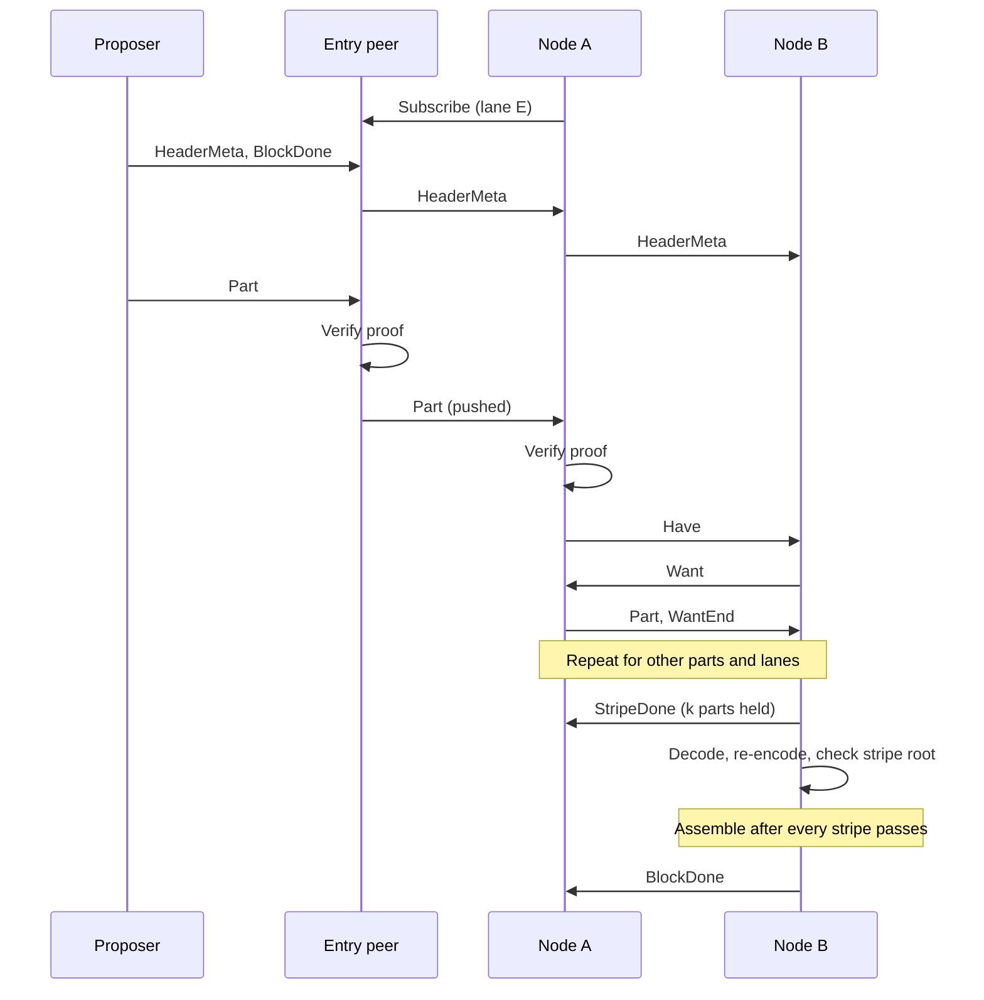

# Dogwood: block propagation for Zcash

Dogwood aims to deliver blocks quickly from any proof-of-work proposer across
peers with unequal bandwidth. It splits a block into erasure-coded parts and
seeds them through nearby entry peers. Receivers first pull announced parts,
then ask consistently fast neighbours to push. Parity lets receivers skip slow
neighbours once they have enough parts to reconstruct the block.

Pull limits redundant traffic. Push saves a request round trip but can overload
the fastest relays. Dogwood uses push only when the receiver chooses it and the
relay has capacity. The [protocol specification](../specs/dogwood.md) defines
the message rules and limits.

## Parts, stripes, and lanes

The proposer splits the body into 64 KiB source parts. Each stripe contains
`k` source parts, up to 64. The proposer adds `ceil(k / 3)` parity parts using
systematic Reed–Solomon over GF(2¹⁶). Any `k` distinct correctly encoded parts
reconstruct a stripe.
A 128 MiB body has 32 stripes, each with 64 source parts and 22 parity parts.

The proposer sends each coded part once to an entry peer. With `R` entry peers,
part `i` goes to `entry_peers[i mod R]`. All parts assigned to an entry peer
form its **lane**. Nodes learn routes per lane, so two proposers that share an
entry peer can use the same learned routes.

The proposer chooses entry peers whose minimum round-trip time is at most twice
the median among its neighbours. Distant entry peers make parts detour before
reaching the rest of the network. To resist attackers that colocate near a
miner, the proposer prefers outbound and configured peers, takes at most one
per network group, and chooses randomly among eligible peers.

### Authenticate before forwarding

`HeaderMeta` carries the consensus header, coding parameters, a Merkle root over
the parts, entry peers, and proposer authentication. Headerchain checks proof of
work and contextual difficulty before the node authenticates metadata or
allocates assembly state. The node accepts at most one authenticated metadata
variant per block and forwards `HeaderMeta` to every peer.

The header does not commit to Dogwood's metadata. The wrapper therefore needs a
signature from a key bound to the mined block. Otherwise, anyone could attach
conflicting metadata to another miner's proof of work. The [candidate
binding](../specs/dogwood.md#bind-the-proposer-to-the-proof-of-work) commits the
key in a coinbase output and proves the transaction's membership in the block.
A txid proof cannot authenticate a key in the V5 coinbase input script. The
post-Tachyon adapter remains open.

Each `Part` carries a Merkle proof. Nodes verify the proof before forwarding or
decoding the part. An entry peer accepts seeds only from the proposer's signed
transport identity.

### Deliver and reconstruct

This example follows one part. A subscribes to entry peer E's lane. B pulls.

`StripeDone` and `BlockDone` use the control stream to stop queued sends.
Parts already in flight count as surplus. The proposer sends `BlockDone` with
its metadata to prevent peers from sending its own parts back.

A proof establishes membership in the committed data. The node checks the
encoding by re-encoding each decoded stripe and comparing its subtree root with
the root from its proofs.
It submits the assembled block for consensus validation after every stripe
passes. Forwarding never waits for decoding.

Stripes bound decode work and let it overlap transfer. The proposer still
encodes the whole body before signing the root. Changing the body requires new
parity and a new Merkle tree. Changing only the header preserves both.

## Pull first, then push

Each lane starts in pull mode. A node requests announced parts until its held
and pending parts total `k` per stripe. A `Want` specifies a stripe, count, and
allowed indices. Concurrent requests use disjoint indices to avoid duplicate
replies.

The node samples a quarter of parts by hash. For each sample, it measures when
each neighbour's copy or `Have` arrives relative to the first arrival.
`Have` follows queued parts on the data stream, so its lag includes queueing.
After each block, the node ranks neighbours per lane using an exponentially
weighted average of these lags.

The node subscribes to a leading candidate that advertises a short forwarding
wait. The parent then pushes the lane for future blocks. If the parent stays
slower than pulling from the best alternative for three learning steps, the
node unsubscribes and resumes pulling. The [route policy](../specs/dogwood.md#7-route-learning)
defines the thresholds and exceptions.

Three constraints keep learned routes usable:

- **Avoid cycles.** A new parent's advertised arrival delay from the proposer's
  signed `created_ms` must be lower than the node's for the same block. This
  ordering prevents cycles among selections made against that block, even with
  clock skew. A node also leaves a parent that subscribes to it for the same
  lane to break cycles formed across blocks.
- **Compare the same block.** Nodes retain 64 blocks of neighbour adverts so a
  lagging node can still find candidates for the block it is learning from.
- **Limit forwarding.** A parent charges each accepted standing lane `1/R` of a
  block against a shared child budget. It refuses excess subscriptions, leaving
  those receivers in pull mode.

## Bounding what peers can send

QUIC flow control alone cannot bound unwanted traffic: reading and dropping a
part immediately refills the receive window. Dogwood instead tracks the parts
wanted from each peer.

| A part is wanted because | Authorization ends when |
| --- | --- |
| The node subscribed to its lane | `SubscriptionEnd` arrives |
| A live `Want` allows its index and has unspent count | The count is spent or `WantEnd` arrives |
| The sender is the proposer and the node is the part's entry peer | The part arrives |

Each peer may send a wanted part once. The node disconnects a peer that sends
an unwanted or duplicate part before checking its proof. Receive traffic is
therefore bounded by the node's requests, subscriptions, and seed slots, plus
a small allowance for unknown blocks.

Cancellation must allow parts already in flight. `Unsubscribe` starts draining.
`SubscriptionEnd` closes the subscription after its queued parts arrive on the
data stream. `WantEnd` follows its replies the same way. A parent that refuses
or stops a subscription sends `Refuse` to request this exchange. Timers never
revoke authorization, so delay alone cannot make an honest sender violate it.

Messages identify a metadata variant rather than just a consensus block hash.
Conflicting variants therefore appear as unknown blocks instead of bad proofs.
Nodes hold unknown-block data in bounded records and pause a peer's data stream
when its record fills. They keep the control stream open for the resolving
metadata. A 16-block propagation window bounds retention of retired blocks.

The [peer message regulation](peer-message-regulation.md) rule is:
disconnect only when no conformant peer could have sent the message. Crossings
and local capacity return `Drop`. The [spec](../specs/dogwood.md#3-lanes-and-route-state)
defines authorization, draining, and retention in full.

## Recovery and adversarial neighbours

Parity tolerates missing parts only while reachable honest sources can supply
`k` parts of every stripe. At one-third parity, withholding about a quarter of
coded parts exhausts that margin. More parity raises the margin at the cost of
proposer and push traffic. Pulling receivers still stop at `k`.

A fast parent can earn a subscription and then withhold a chosen block. A node
therefore also pulls a missing part when another neighbour announced it at
least `STARVE_MS` earlier. The [hole-pull rules](../specs/dogwood.md#holes-under-push)
cover other signs that a parent has skipped a part.

Recovery proceeds in one direction:

1. **Normal delivery:** combine pushes and pulls to collect `k` parts per stripe.
2. **Repair:** after two seconds without a new part, request missing parts in
   bounded rounds, preferring peers that reported `StripeDone` or `BlockDone`.
3. **Full-block download:** fall back when repair ends or a monotonic deadline
   from metadata admission expires. Partial progress never resets the deadline.
   A failed re-encode check or authenticated metadata conflict goes here at once.

### Miner mesh

Miners have an incentive to delay rivals' blocks. They also have an incentive
to relay blocks they build on, because peers mining on a stale tip waste work.
Direct miner connections provide another path when entry peers withhold parts.

Each miner subscribes to its peer miners' own blocks. A proposer pushes every
part to those subscribers in addition to seeding entry peers, until each
subscriber's `StripeDone` stops the stripe. Subscribers can then serve every
lane to their neighbours. These copies add proposer upload beyond the entry-peer
seeds. A miner can propose through a relay it controls to hide its peer topology.

| Delivery path | Required condition |
| --- | --- |
| Entry peers, lanes, pulls, and repair | Reachable honest sources hold `k` parts of every stripe. |
| Miner mesh | Miners peer directly and relay blocks. |
| Header sync and full-block download | An honest path to the full block exists. |

## Performance targets

The planning target is 50,000 TPS at 2 KiB per aggregated transaction after
Tachyon. This requires 819.2 Mbps (97.7 MiB/s) of body traffic before parity,
transport overhead, or recovery. Delivering `T` seconds of transactions in `D`
seconds requires at least `819.2 × T / D` Mbps of ingress. Relays need upload
capacity for each forwarding copy.

The latency target is below 500 ms to reach 90% of nodes, aiming for 400 ms.
A provisional budget allows 150 ms for three roughly 10,000 km fiber hops and
250 ms for routing, serialization, queueing, verification, and reconstruction.
Block size, geography, and available paths determine feasibility. These targets
do not set consensus parameters.

### Current evidence

The `flow` prototype ran on 80 DigitalOcean nodes with 8 vCPUs across 11 regions.
Each node had 28 neighbours in a random regular overlay. Clocks were synchronized;
the trials had no chain or Byzantine peers. `t90` measures when 90% of
non-proposer nodes assembled a block.

| Workload | Router | `t90` |
| --- | --- | --- |
| 32 MiB, one block at a time, rotating proposers | Learned push | 0.40 s |
| 64 MiB, one block at a time, rotating proposers | Learned push | 0.59–0.61 s |
| 32 MiB blocks at 110 MiB/s, one or many proposers | Learned push | 0.40–0.48 s; 0.77 s for the worst-placed proposer |
| 128 MiB, random proposers, parity 1/3 | Pull only; push with a child budget | 1.03 s; 0.91 s |
| 256 MiB, random proposers | Pull only at parity 1/3; learned push at parity 0.1 | 1.59 s; 2.16 s |
| Two 256 MiB blocks at once | Pull only at parity 1/3; learned push at parity 0.1 | 2.73 s; 3.85 s |

Every block reached every node. The 32 MiB trials sustained the planning
throughput, but the worst-placed proposer exceeded the latency target.
At 256 MiB, queueing dominated learned push as the busiest relay uploaded about
four times the body. Pull received 1.02–1.05 times the body and needed no repair.
These results motivate pull as the default. The comparison also changes parity.

Stripes reduced the decode tail to 115–180 ms at `p90`, compared with about two
seconds for a single 256 MiB codeword. A child budget of about 1.4 blocks reduced
the busiest relay's upload to 2.7 blocks and improved latency at 128 MiB.
Neither result selects production parameters. The [experiment report](dogwood-experiments.md)
records the local codec and controller experiments behind the first draft.

## Parameter tuning

The [spec parameter registry](../specs/dogwood.md#parameter-registry) owns
starting values and change rules. Three choices dominate:

- **Parity:** more parity lets pulls skip slow or withholding peers but raises
  proposer upload and push traffic.
- **Push threshold and child budget:** earlier promotion saves round trips;
  tighter budgets limit concentration on fast relays.
- **Stripe size:** smaller stripes decode sooner but increase proof and message
  overhead.

Record parameter versions with results. Local policy can change within the
spec's bounds; wire changes require negotiation.

## Open work

- **Routing:** choose a child budget across block sizes, test entry-peer
  selection for poorly connected proposers, and measure whether any shared lane,
  parent, or pull-window state should split by proposer.
- **Withholding:** choose parity for a target withholding share and test giving
  trusted entry peers source parts while random peers receive parity. Explore
  proof of recent mining to authenticate mesh peers without configuration.
- **Encoding:** test commitments to per-stripe roots so the proposer can send
  while encoding. Select the codec construction and test vectors.
- **Integration:** finish the production chain adapter, transport negotiation,
  and aggregate resource limits. The [W2 payload profile](../specs/dogwood.md#candidate-payload-profile-w2)
  does not complete these choices.
- **Validation:** test changing capacity and adversarial peers with chain
  integration. Measure normal delivery, repair, and fallback separately.

## Related protocols

Dogwood combines bounded forwarding like
[Gossipsub](https://github.com/libp2p/specs/blob/master/pubsub/gossipsub/gossipsub-v1.0.md#gossipsub-the-gossiping-mesh-router),
erasure-coded seeding like
[Rotor](https://www.anza.xyz/blog/alpenglow-a-new-consensus-for-solana),
`Have`/`Want` discovery like Celestia's
[PBBT](https://github.com/celestiaorg/celestia-app/blob/9c1e04d1dfd090531252f16f34293242d04b1157/specs/src/recovery.md),
and route learning from local delivery measurements like
[DOG](https://github.com/cometbft/cometbft/issues/3263). Its routing unit is a lane
keyed by entry peer, with receivers choosing between pull and push.
